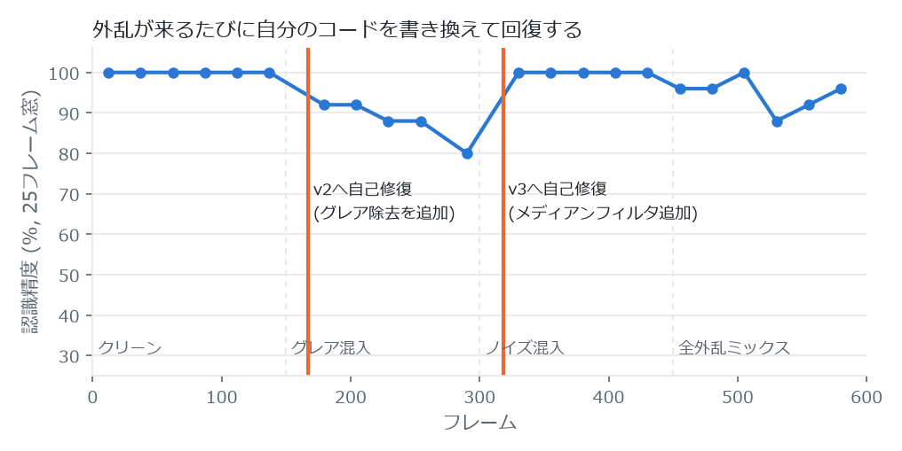

# self-healing-vision — 自己書き換え型 組み込み画像認識エンジン

認識エラーの原因を数理的に特定し、自分のC++コード(計算グラフ定義)を書き換え、
g++で自分自身を再ビルドして新世代に制御を移譲するデモ。依存ライブラリなし。

<picture>
  <source media="(prefers-color-scheme: dark)" srcset="docs/timeline-dark.png">
  
</picture>

| 区間 | 内容 | 精度 |
|---|---|---|
| P0 f0〜149 | クリーン | 150/150 (100.0%) |
| P1 f150〜299 | 鏡面反射(グレア)混入 → v2 へ自己修復 | 128/150 (85.3%) |
| P2 f300〜449 | ごま塩ノイズ混入 → v3 へ自己修復 | 140/150 (93.3%) |
| P3 f450〜599 | 全外乱ミックス | 142/150 (94.7%) |

v2 では一度、追加の修正候補(グレア閾値 0.71)を「改善幅が基準に届かない」として**自分で棄却**しています。
修正は回帰ゲート(クリーン画像で精度95%以上など)を通過したときだけ採用されます。

## 実行

```bat
build.bat        :: v1にリセットしてビルド
engine_v1.exe    :: このフォルダをカレントにして実行
```

600フレームのシナリオが自動で流れる:
f150〜 鏡面反射(グレア) → 精度崩壊 → v2へ自己修復、
f300〜 ごま塩ノイズ → 再崩壊 → v3へ自己修復、f450〜 全外乱ミックスで最終検証。

## 自己修復サイクル

```
認識ループ ─→ ウォッチドッグ(直近25フレームでエラー6件以上)
              │
              ▼
        ①数理診断 (diagnose.hpp)
           失敗フレーム群の統計量で原因を仮説判定
           ・飽和画素率 + 飽和画素の空間凝集度 → 鏡面反射(塊)かごま塩(散在)か
           ・孤立極値率(3x3中央値からの乖離検定) → インパルス性
           ・輝度ヒストグラムのKLダイバージェンス → 校正時分布からの逸脱の証拠
              │
              ▼
        ②修正の最適化
           ・グレア: クリップ閾値を[0.50,0.99]グリッド直接探索し、
             最大精度プラトーの中点を採用(マージン最大化)。
             ※精度は閾値に対し区分定数なので勾配法/黄金分割は不適切
           ・ノイズ: median3x3段の追加(離散的グラフ編集)を事前検証
           適用基準: 絶対精度90%以上 かつ 現行グラフのエラー率を半減
              │
              ▼
        ③自己書き換え+再ビルド (selfpatch.hpp)
           generated_params.hpp を書き出し → g++ で engine_v{N+1}.exe
              │
              ▼
        ④回帰ゲート
           新exeに --selftest clean(95%) + 修正対象モードを課す。
           不合格 → パラメータをロールバックしexe破棄(劣化防止)
           合格   → state.txt に状態を保存し新exeへ制御移譲、自分は退役
```

## ファイル構成

| ファイル | 役割 |
|---|---|
| `engine.cpp` | メインループ・ウォッチドッグ・selftest・状態引き継ぎ |
| `pipeline.hpp` | 計算グラフ実行器: [glare_clip] → [median3x3] → 二値化 → 最大連結成分 → 特徴量(充填率,コンパクト度) → 最近傍重心分類 |
| `diagnose.hpp` | 原因特定の統計量と修正パラメータ最適化 |
| `selfpatch.hpp` | ヘッダ生成・再ビルド・回帰ゲート・世代交代 |
| `generated_params.hpp` | **エンジン自身が書き換える計算グラフ定義**(履歴コメント付き) |
| `params_baseline.hpp` | v1の原本(build.batが復元に使用) |
| `imagegen.hpp` | 合成センサ入力: 図形○□△ + グレア/ごま塩注入 |

## 設計メモ

- **グレア修復**: 飽和画素をオニオンピール(前景/背景多数決の伝播)でインペイントし、
  さらに凸性事前分布で復元 — 遮蔽されていた画素に限り最大成分の凸包内をFGで埋め、
  深い切り欠きを浅い面取りに変換する。飽和画素以外に触れないため、
  ごま塩のpepper穴は隠れず、別の故障モードとして正しく再検知される。
- **セルフキャリブレーション**: 各世代は起動時に自分のグラフ構成でクラス重心を測り直す。
  グラフを書き換えても分類器との整合が自動で取れる。
- **再起動方式**: 実行中のexeはWindowsでは上書きできないため、
  `engine_v{N}` が `engine_v{N+1}` をビルド→検証→起動して退役する
  (組み込みのA/Bパーティション更新に相当)。ストリームはフレーム番号から
  決定的に生成されるので、新世代は中断フレームの続きから処理する。

## 実機との対応(このデモの簡略化)

- カメラ入力 → 合成画像(図形+外乱注入)
- 教師信号 → シミュレータの真値(実機では冗長系センサや上位系の遅延ラベルに相当)
- 認識器 → 2特徴の最近傍重心分類(原理はCNNの計算グラフ差し替えでも同型)
- 同時実行は非対応(状態・パラメータファイルを排他制御していない)

## ライセンス

[MIT License](LICENSE) © 2026 purplecatman2005-dev
